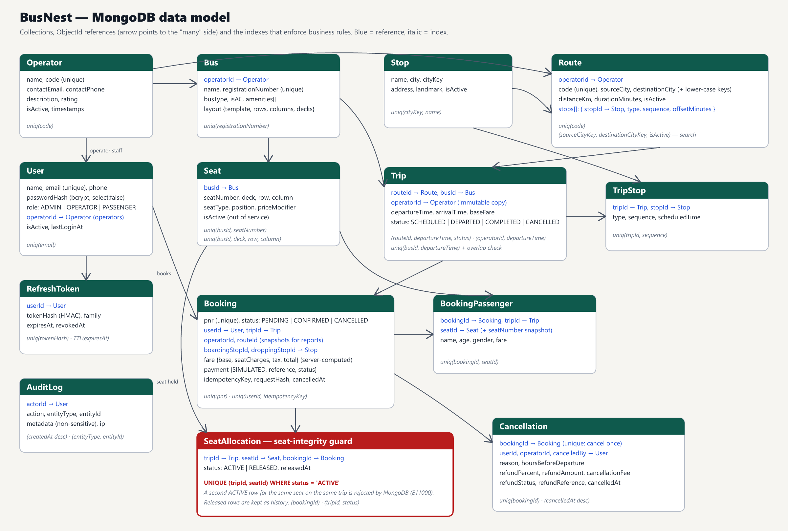

# BusNest — Technical Report

This report explains the main architectural and database decisions, with most attention on the hardest requirement: **seat integrity under concurrent booking**.

## 1. Architecture

BusNest is a **modular monolith**: one Express API and one React SPA, deployed separately (Render and Vercel) against one MongoDB Atlas cluster. A monolith keeps the transactional booking path in a single process and database, which is what the integrity guarantees depend on; the domain modules (`auth`, `operators`, `buses`, `seats`, `stops`, `routes`, `trips`, `bookings`, `cancellations`, `reports`, `audit`) give the separation that microservices would, without distributed-transaction problems.

Request flow inside the API:

```
helmet → CORS allow-list → JSON body (100 kB) → cookie parser → Mongo-operator stripping
→ request logger → rate limiter → router
   → authenticate (JWT) → authorize(roles) → validate (Zod: params/query/body)
   → controller (HTTP only) → service (business rules, DB) → envelope response
→ central error handler (AppError / Zod / Mongoose / E11000 → consistent JSON + status)
```

Controllers never touch the database; services never touch `req`/`res`. All business rules — fares, availability, ownership, state transitions, refund maths — live in services and are therefore covered by the API tests.

**Configuration.** `config/env.ts` validates every environment variable with Zod at startup and exits with a list of variable *names* and reasons, never values. Connection errors are sanitised so a connection string cannot leak into logs.

**Connection handling.** The initial connection retries with exponential back-off; after that the driver reconnects automatically and disconnect/reconnect events are logged. `/health` reports database readiness and whether transactions are available. On startup the API builds all indexes before listening, because seat integrity depends on them existing.

## 2. Data model



Key choices:

| Decision | Reason |
|---|---|
| **Route** is a template (cities, ordered stops with minute offsets); **Trip** is a dated instance; **TripStop** materialises a trip's stop times | Editing a route never rewrites history: existing trips and tickets keep their own stop times. |
| **Seat** is its own collection, generated from a layout template (2+2, 2+1, semi-sleeper, two-deck sleepers) with `deck/row/column` | The seat map is rendered from real data, any seat can be taken out of service or priced individually, and allocations reference a stable `seatId`. |
| **SeatAllocation** is a separate collection | It carries the one constraint that matters most (below) and keeps released allocations as history. |
| **Booking** stores a frozen fare breakdown and snapshots of `operatorId`/`routeId`; **BookingPassenger** stores `seatNumber` and per-seat fare | Fare changes and layout edits never alter issued tickets; reports and operator scoping need no joins. These copies are written once at booking time and never updated, so they cannot drift. |
| **Trip.operatorId** copied from route/bus and marked `immutable` | Operator authorisation is a single indexed equality check. The service rejects a bus and route from different operators. |
| **Cancellation** has a unique `bookingId` | A booking can be cancelled exactly once, enforced by the database. |
| **RefreshToken** stores an HMAC of the token, with a TTL index on `expiresAt` | A database leak exposes no usable session; expired sessions clean themselves up. |

Indexes are chosen for the actual queries: route search `(sourceCityKey, destinationCityKey, isActive)`, trip lookup `(routeId, departureTime, status)`, operator dashboards `(operatorId, departureTime)` and `(operatorId, createdAt)`, a passenger's bookings `(userId, createdAt)`, availability `(tripId, status)` on allocations. Unique indexes encode rules: `pnr`, `(userId, idempotencyKey)`, `(busId, seatNumber)`, `(busId, deck, row, column)`, `(busId, departureTime)`, `(tripId, sequence)`, operator `code`, bus `registrationNumber`, user `email`.

## 3. Seat integrity and concurrent booking

### 3.1 The guarantee

```js
seatAllocationSchema.index(
  { tripId: 1, seatId: 1 },
  { unique: true, partialFilterExpression: { status: 'ACTIVE' }, name: 'uniq_active_trip_seat' },
);
```

MongoDB itself refuses a second `ACTIVE` allocation for the same seat on the same trip. It does not matter how many API instances run, how requests interleave, or whether application-level checks are stale: the insert that reaches the index first wins and every other insert fails with `E11000`, which the service turns into **409 `SEAT_ALREADY_BOOKED`** with the list of lost seats. Because the index is *partial*, a cancelled booking's allocation flips to `RELEASED` and the seat can be sold again while the old row stays as history.

The pre-checks before the insert (seat belongs to the bus, seat in service, trip open, stops valid) exist to give precise error messages. Correctness never depends on them — a classic *check-then-insert* race is harmless because the insert is what is guarded.

### 3.2 Booking algorithm

1. **Idempotency lookup.** `(userId, Idempotency-Key)` already exists → return the original booking (`200`, header `Idempotent-Replayed: true`). Same key with a different payload (SHA-256 of the canonical request) → `422 IDEMPOTENCY_KEY_REUSED`.
2. **Validate** on the server: trip exists, `SCHEDULED`, not departed; every seat belongs to the trip's bus and is in service; one passenger per distinct seat; at most 6 seats; boarding and dropping are stops of this trip of the right type and in order.
3. **Price** from database values only: `baseFare × seats + Σ seat premiums + GST`. The request schema has no price, status or PNR fields, and Zod strips unknown keys, so client-supplied values cannot even reach the service.
4. **Persist** booking + allocations + passengers (3.3), with a freshly generated PNR.
5. **Map failures:** E11000 on `uniq_active_trip_seat` → 409 seat conflict; on `(userId, idempotencyKey)` → a simultaneous duplicate won, replay it; on `pnr` → draw a new PNR and retry (up to 5 times).

PNRs are `BN` + 8 characters from a 32-symbol alphabet without `0/O/1/I` (≈ 10¹² combinations) drawn from `crypto.randomInt`. Uniqueness is not assumed: the unique index rejects collisions and the service retries — tested by forcing the generator to return the same PNR twice.

### 3.3 Two persistence strategies — chosen by verifying the deployment

At connection time the API runs `hello` and enables transactions only if the deployment is a replica set or `mongos` (`MONGODB_TRANSACTIONS=auto|on|off` can override). Atlas is always a replica set; a plain local `mongod` is not.

**With transactions (Atlas):** booking, allocations and passengers are written inside `session.withTransaction`. Either all commit or none do. Under contention, MongoDB raises a write conflict on the second transaction, `withTransaction` retries it, and the retry hits the unique index → clean 409, nothing left behind.

**Without transactions — explicit compensation:**

1. Insert the booking as **`PENDING`** (not visible as a valid ticket; excluded from all listings and reports).
2. Insert allocations with `ordered: true`. The unique index stops a double sale exactly as before.
3. Insert passengers; then flip `PENDING → CONFIRMED` with a conditional update.
4. On any failure, **compensate**: delete this booking's allocations and passengers and the pending booking, then rethrow.

A crash between steps can leave a `PENDING` booking holding seats. `reconcileBookings()` runs at startup and every 5 minutes: it discards `PENDING` bookings older than two minutes (freeing their seats) and releases any `ACTIVE` allocation still attached to a `CANCELLED` booking. A partially completed booking is therefore never accepted as confirmed, and stuck seats are recovered automatically.

### 3.4 Partial allocation

Requesting seats A and B when B is taken: with transactions, the insert of B aborts the transaction and A is never committed; without, compensation deletes A. Both paths are tested — A remains free and can be booked immediately afterwards.

### 3.5 Stale availability in the UI

The seat map comes from `GET /trips/:id/seats` (`Cache-Control: no-store`), is polled every 15 s and on focus, and deselects any seat that has become unavailable with a notice. Checkout re-reads availability on load. If confirmation still loses a race, the 409 sends the passenger back to the seat map with the taken seats named. Each checkout attempt carries one `Idempotency-Key` (kept in `sessionStorage`), so double-clicks, retries after a network error and page refreshes cannot create a second booking.

## 4. Cancellation and refunds

`calculateRefund(total, departure, now, policy)` is a pure function and the only place refunds are computed; the preview endpoint and the cancellation itself both call it. The policy is configurable through `CANCELLATION_CUTOFF_HOURS` and `CANCELLATION_TIERS`; defaults: ≥48 h 100 %, ≥24 h 75 %, ≥12 h 50 %, otherwise 0 % (cancellable but no refund), and refused inside 2 h of departure or after departure.

Cancellation order (inside a transaction when available):

1. `findOneAndUpdate({ _id, status: 'CONFIRMED' } → CANCELLED)` — an atomic state transition; a second concurrent request matches nothing and gets `409 ALREADY_CANCELLED`.
2. Insert the `Cancellation` (unique `bookingId` is a second guard) with refund amount, fee, simulated refund reference and status.
3. Release allocations (`ACTIVE → RELEASED`) **last**, so a seat is never resold before the cancellation is recorded. Without transactions, a failure in step 2 restores the booking; a crash after step 2 is repaired by reconciliation.

The booking, its passengers and its released allocations are never deleted. When an operator or admin cancels a whole trip, every confirmed booking is cancelled with a 100 % refund. Trip status follows `SCHEDULED → DEPARTED → COMPLETED` or `SCHEDULED → CANCELLED`; other transitions are rejected.

## 5. Authentication and authorisation

- Passwords: bcrypt (cost 12). Login compares against a dummy hash for unknown emails, so timing and messages do not reveal which emails exist.
- **Access token:** JWT (HS256, 15 min, issuer/audience checked), kept in memory in the browser — never in `localStorage`.
- **Refresh token:** 48 random bytes in an `httpOnly` cookie scoped to `/api/v1/auth` (`Secure; SameSite=None` in the cross-site deployment). Stored as an HMAC, rotated on every refresh by an atomic claim, grouped in a *family*; presenting an already-rotated token outside a 15-second grace window revokes the whole family (theft detection). Password change, deactivation and role change revoke all of a user's sessions.
- **RBAC on the server:** `authorize(...roles)` on each route, plus scoping in the service: operators are restricted to their `operatorId` (query parameters cannot widen it), passengers to their own bookings (other people's bookings return 404, not 403, to avoid confirming they exist). Public registration always creates a `PASSENGER`; a `role` field in the body is ignored.
- Frontend route guards exist for navigation only.

## 6. Reporting

All dashboard figures are aggregation pipelines over live collections, scoped by the same operator filter: bookings by status, seats sold, revenue (confirmed fares + retained cancellation fees), refunds, occupancy (active allocations ÷ in-service seats of non-cancelled trips in a ±30-day window), route-wise summaries, a gap-filled 14-day trend in IST, and recent activity. Manifests list confirmed passengers in seat order with PNR, contact and boarding/dropping points.

## 7. Security checklist

Helmet headers; CORS allow-list with credentials; JSON body limit; `$`/`.`-key stripping plus Zod type-checking (Express 5's simple query parser yields flat strings only); rate limits (auth 30 / 15 min, booking 30 / min, API 600 / 15 min); ObjectId validation on every id; consistent status codes; request logs with method, path, status, latency and user id only; audit log of logins, bookings, cancellations and configuration changes; secrets in git-ignored `.env`.

## 8. Trade-offs and future work

- A short **seat hold** (e.g. a 5-minute `HELD` allocation with a TTL) would stop passengers losing a seat at the last step; it fits the same partial-index design.
- Search filters and sorts one day's trips in memory; at larger scale this becomes an aggregation with `$lookup` and pagination in the database.
- Per-passenger partial cancellation, payment-gateway integration, notifications and per-operator cancellation policies are natural extensions.
